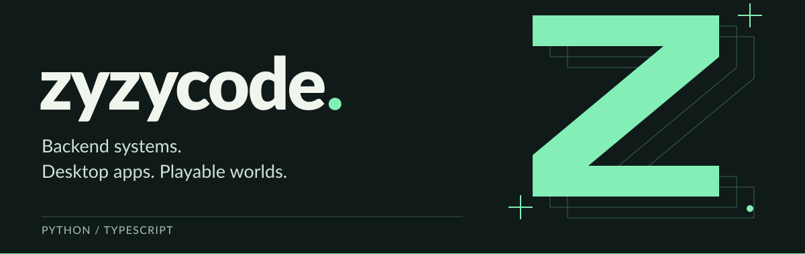

<a href="#selected-projects">
  <picture>
    <source media="(max-width: 600px)" srcset="https://raw.githubusercontent.com/zyzycode/zyzycode/main/assets/header-mobile.svg" />
    
  </picture>
</a>

  <a href="#about">About</a> &nbsp; / &nbsp;
  <a href="#github-stats">Stats</a> &nbsp; / &nbsp;
  <a href="#stack">Stack</a> &nbsp; / &nbsp;
  <a href="#selected-projects">Projects</a> &nbsp; / &nbsp;
  <a href="https://github.com/zyzycode?tab=repositories">Repositories</a>

## About

I'm **zyzycode**, a backend and LLM engineer working across **Python, Go and TypeScript**. I build APIs and asynchronous services, and integrate language models with data, tools and backend systems.

My work spans event-driven architecture, databases, automation, performance optimization and Linux infrastructure. I also build desktop applications and games — taking ideas from backend logic all the way to a working interface.

## GitHub stats

  
  

Updated daily · Public GitHub activity · Language shares reflect repository code.

## Stack

<picture>
  <source media="(max-width: 600px)" srcset="https://raw.githubusercontent.com/zyzycode/zyzycode/main/assets/stack-mobile.svg" />
  
</picture>

<strong>Full stack — searchable text version</strong>

| Area | Technologies & practices |
| :--- | :--- |
| AI & LLM engineering | RAG · MCP · Llama · LLM integration · AI applications |
| Languages & runtimes | Python · Go · TypeScript · SQL · Bash · asyncio |
| Backend & APIs | FastAPI · Django · Flask · REST APIs · JSON APIs · gRPC · Pydantic |
| Asynchronous systems | RabbitMQ · Celery · FastStream · Event-driven architecture |
| Databases & storage | PostgreSQL · ClickHouse · MongoDB · Redis · SQLAlchemy · Alembic |
| Testing & optimization | pytest · Selenium · Postman · Performance optimization · Code optimization |
| Infrastructure & delivery | Linux · Docker · Docker Compose · CI/CD · Git · GitHub · GitLab |
| Development tools | PyCharm · Bash |
| Interfaces, desktop & games | React · Electron · Vite · Phaser |

## Selected projects

### [Project Wisp ↗](https://github.com/zyzycode/project_wisp)

**An AI companion that lives on your desktop.**

An Electron application with a React interface, local memory and an offline-first desktop runtime, backed by Python/FastAPI. Local functionality and external AI calls are separated across process boundaries.

`LLM applications` `Electron` `React` `TypeScript` `Python` `FastAPI`

---

### [Async Payments Service ↗](https://github.com/zyzycode/async-payments-service)

**Accept the request. Process the payment. Deliver the webhook.**

Asynchronous payment processing with a simulated gateway: idempotent requests, a transactional outbox, RabbitMQ, retry backoff and a dead-letter queue. Ports & Adapters keeps business logic independent of infrastructure.

`Python` `FastAPI` `PostgreSQL` `SQLAlchemy` `RabbitMQ` `Docker`

---

### [Ashen Path ↗](https://github.com/zyzycode/zombz-like-starter)

**A roguelike built around combat, progression and another run.**

A single-player top-down game in alpha: six levels across three biomes, combat, magic, equipment and persistent upgrades. The game simulation is independent of Phaser, React and browser storage.

`TypeScript` `Phaser` `React` `Vite`

---

<a href="https://github.com/zyzycode?tab=repositories">Explore the code →</a>

